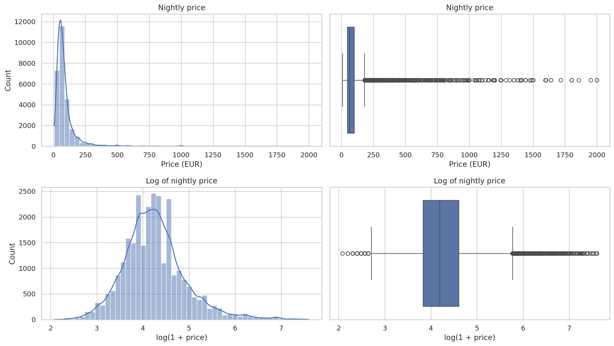

# Rome Airbnb Listings: Exploratory Data Analysis

What drives nightly price and review quality for Airbnb listings in Rome?

**Use case:** A host or platform wants to understand which listing and host features relate to nightly price and review quality in Rome.

## Key findings

- **Location matters.** Centro Storico has the highest median price (€79), against €40–60 in most other areas.
- **Capacity and room type drive price.** Capacity has the strongest numeric link to price. Entire places cost more than private rooms (median €77 vs €49).
- **Superhosts get better reviews.** Superhosts average 96.8 vs 92.0 for other hosts, and a randomly chosen superhost has the higher rating about 7 times in 10 (Mann-Whitney test).
- **Instant booking and minimum stay barely affect price.**

## Data

Source: [Airbnb listings on Kaggle](https://www.kaggle.com/datasets/ulrikthygepedersen/airbnb-listings) (200k+ listings across several cities).
I used Rome only, because prices are in a single currency (EUR) and there are enough rows (27,575 after cleaning).

The raw file is not included in this repo. To run the notebook:
1. Download `Listings.csv` from the Kaggle link above.
2. Place it in a `data/` folder next to the notebook.

## Method

- **Cleaning:** dropped 16 uninformative columns, removed rows with missing host data, prices ≤ 0, minimum stays above 365 nights, and prices above €2,000 (many were repeated placeholder values). This lost 0.26% of the data.
- **Transformations:** log(1 + price) because price is heavily right-skewed (skew 6.67).
- **Analysis:** summary statistics, histograms and boxplots, Pearson and Spearman correlations, Mann-Whitney U test, chi-square test with Cramér's V.

## Tech

Python, pandas, NumPy, Matplotlib, seaborn, SciPy.

## Author

João Marcos Carniel · [LinkedIn](https://www.linkedin.com/in/joao-marcos-carniel-180a901b8/) · [Blog](https://hashnode.com/@joaomarcoscarniel)
